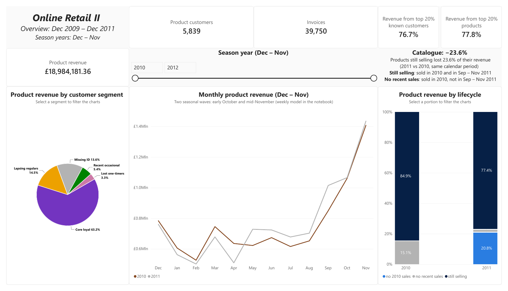

# Online Retail II – who buys, when, and what to do about it

Two years of transactions (Dec 2009 – Dec 2011) from a UK online gift retailer
that sells mostly to wholesalers, cleaned in **MySQL**, analysed in **Python**
and presented in **Power BI**.

## Summary

Years run from December to November, so that each holds a full season.

Returns were matched in SQL to the purchases they cancel.

Revenue held level only because new products replaced a declining range.

Customers buy by the calendar, in November above all, and 264 of them are
candidates for a call or a campaign.



[Full report](report/REPORT.pdf) | [Notebook](python/online_retail_notebook.ipynb) | 
[Power BI dashboard](powerbi/online_retail_dashboard.pbix) ([PDF](powerbi/online_retail_dashboard.pdf)) | 
[Action lists](output/)

## Key findings

- **The existing range is being replaced.** Product revenue remained stable in
  2011 (+2.0% ± 2.9% week by week), but products no longer sold lost **£1,215k**
  and products still selling £552k; new products, which added £1,949k, more
  than made up for both. The products still selling lost buyers, not order size:
  each reached **26.7%** fewer known customers, who ordered as much (same price).
- **Customers buy by the calendar.** The season comes in two waves, early
  October and mid-November, and November alone brings about half of the extra
  seasonal revenue (**£798k** in 2011-11, **£771k** in 2010-11). The lesser
  wave in October comes from many customers, not a few large accounts. Lines
  without customer ID behave like a separate channel and buy later, in early December.
- **Customers can be split into four segments** (*Core loyals, Lapsing regulars,
  Recent occasionals, Lost one-timers*), from how recently, how often and how
  much they buy. Core loyals are **22%** of known customers and bring **73%**
  of their revenue. 81% of the top 20% of customers, who bring **76.7%** of
  known customers' revenue, are Core loyals. Most of the top customers stay:
  **60.5%** of 2010's were still in the top 20% in 2011.
- **264 customers (4.5%, £1.27M of past revenue) are candidates for action**,
  in four lists: *Protect, Win back, Upgrade, Retain*.
- **1,785 products are also candidates for action (264 with priority)**, in
  six lists: *Invest, Broaden, Refresh, Review, Investigate, Check customer*.

## Recommendations

- **Account managers.** *Protect* (54 customers, **£644k**): call Core loyals
  who have missed two usual orders, the most valuable first. *Win back* (43
  customers, **£445k**): contact Lapsing regulars who have probably stopped.

- **Sales and marketing.** *Upgrade* (86): follow up Recent occasionals whose
  orders already look like core customers'. *Retain* (81): automated reminders
  for Recent occasionals drifting away. *Be ready by early September* for the
  seasonal waves, and keep the channel without ID stocked until Christmas.

- **Category managers.** *Keep renewing the range*, starting from the high
  band. *Promote the Invest products* and *refresh the Refresh ones* (96 + 111
  priority products). *Investigate the steepest falls* before any decision
  (18 + 5 priority products), checking the main customer first when the base
  is narrow.

- **Data.** *Record the customer ID on every order*: it is missing on **22.8%**
  of lines, **15.7%** of revenue. *Tell returns apart from cancellations* for
  a quality analysis of returns and *record costs* for a ranking by profit.

## Dashboard

All pages in [PDF](powerbi/online_retail_dashboard.pdf); open [`online_retail_dashboard.pbix`](powerbi/online_retail_dashboard.pbix)
in Power BI Desktop to use the filters.

The overview counts product lines only: **£18.98M** of product revenue and the
**5,839** customers who bought products, against the **£19.73M** and **5,859**
known customers of all lines. The segment chart also includes the lines without
customer ID and therefore counts Core loyals as **63.2%** of product revenue,
instead of 73.2% of customer revenue.

## The key step: returns matched to purchases (SQL)

Each return is subtracted from the earlier purchases of the same customer,
product and price, most recent first, so revenue is removed at the right
date and cancelled orders do not count as purchases (**90.6%** of returned
units matched). Simplified from [`sql/sql_cleaning.sql`](sql/sql_cleaning.sql):

```sql
WHILE qty_left > 0 DO              -- most recent purchase still open
  SET p_id = (SELECT id FROM purchase_remaining
              WHERE customer_id = r_cust AND stock_code = r_code
                AND price = r_price AND invoice_date <= r_date
                AND qty_remaining > 0
              ORDER BY invoice_date DESC, id DESC LIMIT 1);
  IF p_id IS NULL THEN LEAVE purchases_loop; END IF;
  SET qty_taken = LEAST(qty_left, (SELECT qty_remaining
                  FROM purchase_remaining WHERE id = p_id));
  UPDATE purchase_remaining
  SET qty_remaining = qty_remaining - qty_taken WHERE id = p_id;
  SET qty_left = qty_left - qty_taken;
END WHILE;
```

## How the analysis was done

- **SQL**: one logged, re-runnable step per cleaning rule, with CTEs and
  window functions.
- **Python**: two gaussians fitted to weekly revenue; segments from my own
  k-medoids (ported from [C](https://github.com/sebian-26/C89_PROJECT_GENOMIC_SEQUENCES/blob/main/src/cluster.c));
  an overdue rule and a BG/NBD model, backtested at three past dates; 
  products split into bands and their growth split into buyers, lines, units and price.
- **Limits**: two seasons only, so no forecast, and the October wave rests
  on few weeks; not all rules were backtested; Upgrade and Retain hinge on
  one threshold (40–233 and 28–167 customers); revenue is not profit (no
  costs), and 22.8% of lines have no customer ID.

## To reproduce

1. Load the two sheets of the [UCI](https://archive.ics.uci.edu/dataset/502/online+retail+ii) Excel file into MySQL 8 (layout: [full report](report/REPORT.pdf), last page).
2. Run `sql/sql_cleaning.sql` and copy its two CSV exports to `data/`.
3. `pip install -r requirements.txt` and run the notebook: it writes `output/` and `figures/`.

## Repository

```
sql/               cleaning and exporting to Python
python/            notebook and helpers
data/              CSV files (not versioned)
output/            action lists and Power BI tables
figures/           charts
powerbi/           Power BI dashboard and its PDF version
report/            full report
requirements.txt   Python packages
```

## License
**Code**: [MIT](LICENSE).

**Data**: Chen, D. (2012). *Online Retail II*. UCI Machine Learning Repository. https://doi.org/10.24432/C5CG6D (CC BY 4.0).
